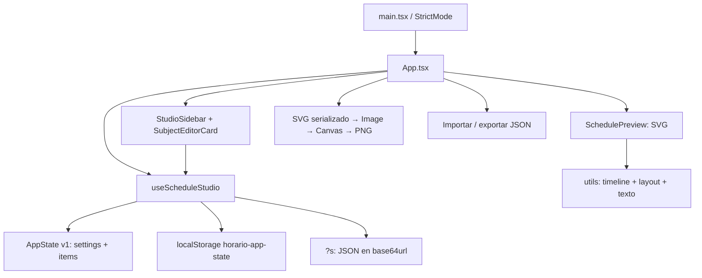

# Auditoría del código actual

Fecha: 13 de octubre de 2026. Revisión del repositorio en `12263da`. Este documento analiza el código existente y propone decisiones para la reconstrucción. No se modificó `src`, el manifiesto ni el lockfile.

El problema central está en el dominio: cada bloque guarda su propia copia del nombre y los colores de una materia. Además, el programa acepta datos externos que sus componentes no pueden representar y puede sobrescribir el horario guardado al abrir un enlace inválido. Conviene resolver estas bases antes de construir las herramientas del estudio y reemplazar el motor de composición.

## Cobertura y método

Se revisaron completos `App.tsx`, los tipos, el hook del estudio, las utilidades y los cuatro componentes de la funcionalidad de horarios. También se revisaron CSS, entrada de React, HTML, configuración de TypeScript, Vite, ESLint, manifiesto, lockfile y los controles compartidos que usa esa funcionalidad. Los restantes componentes de `components/ui` se inventariaron mediante sus imports y usos. No se encontró `AGENTS.md` en el repositorio ni en los ancestros comprobados hasta `C:/`.

Se aplicaron las instrucciones de `unslop`, `writing-clearly-and-concisely`, `vercel-react-best-practices` y `better-accessibility`. El análisis de accesibilidad aquí es de código y no reemplaza una prueba con teclado y lector de pantalla.

Las comprobaciones de funciones ejecutaron el código real, empaquetado en memoria con esbuild. Se usó `renderToStaticMarkup` con JSX automático para probar el componente SVG. La reproducción de persistencia sustituyó `window` por un objeto en memoria: no tocó el almacenamiento del navegador del usuario. El build sólo produjo `dist` y archivos de caché ignorados por Git. No se creó una suite ni se alteró el comportamiento de la aplicación.

| Comprobación | Resultado observado |
| --- | --- |
| `npm run build` | Código de salida 0. Vite 8.0.3 generó JS de 448,32 kB, 144,49 kB gzip, y CSS de 78,34 kB, 13,38 kB gzip. El build informó 30,27 s y un aviso de tiempo en plugins. |
| `npm run lint` | Código de salida 0, sin hallazgos. |
| Funciones de validación, tiempo, geometría, leyenda y enlaces | Casos y resultados concretos en las secciones siguientes. |
| Render estático del SVG | Confirmó excepciones de tipos/enums y rectángulos idénticos para bloques solapados. |
| `bun audit --json` | Código de salida 1. Informó 93 entradas de avisos en 21 paquetes: 6 bajas, 50 moderadas, 36 altas y 1 crítica. Algunas entradas comparten advisory; no son 93 vulnerabilidades distintas ni 93 vías de explotación comprobadas. |
| `bun why vite`, `bun why @modelcontextprotocol/sdk`, `bun why proxy-addr` | Confirmó las versiones y cadenas de dependencia descriptas en seguridad. |
| Versiones del entorno | Node 22.23.1, npm 10.9.8 y Bun 1.3.14. |

Los hallazgos etiquetados como **comprobados** tienen evidencia directa de código, ejecución o ambas. Los **inferidos** describen consecuencias que todavía necesitan una prueba en navegador, una medición o verificar condiciones de exposición. Este recorrido no controló el navegador. Se integraron después los resultados de la auditoría del equipo en Chromium 153.0.8010.12, ejecutada en un contexto aislado, documentados en [browser-results.json](evidence/browser-results.json). Esa evidencia incluye descarga PNG real, pérdida por enlace inválido, caída por importación/cuota, inspección de switches y móvil emulado. Siguen pendientes Safari, Firefox, impresión, lector de pantalla, teléfonos físicos, red offline y rendimiento interactivo.

## Arquitectura existente

La organización por funcionalidad es útil y las actualizaciones de React usan funciones sobre el estado anterior. El render del documento ya es SVG y la exportación parte del nodo SVG existente, una base aprovechable para evitar dos composiciones distintas. Los object URLs se liberan tanto en descarga como en exportación PNG. Estas propiedades conviene conservar conceptualmente.

No hay backend, autenticación, sincronización remota ni múltiples documentos en el recorrido actual. El estado vive en un único `useState`, se guarda en una sola clave de `localStorage` y se exporta entero. El modelo `version: 1` no tiene un migrador.

## Hallazgos priorizados

P0 significa evitar pérdida de información antes de activar una migración. P1 bloquea una parte principal del producto pedido o permite fallos de representación. P2 afecta experiencia, mantenibilidad o resistencia a casos límite. P3 es limpieza documental o técnica. La prioridad de producto se distingue de la severidad de los advisories de dependencias.

| ID | Prioridad | Estado | Hallazgo | Evidencia principal |
| --- | --- | --- | --- | --- |
| C01 | P0 | Comprobado | Un enlace inválido devuelve el documento por defecto y la persistencia posterior reemplaza el horario guardado. | `src/features/schedule/utils.ts:112`, `src/features/schedule/use-schedule-studio.ts:30` |
| C02 | P1 | Comprobado | La importación acepta enums y tipos que hacen fallar el render fuera de su `try/catch`. | `src/App.tsx:79`, `src/features/schedule/utils.ts:76`, `src/features/schedule/components/schedule-preview.tsx:43` |
| C03 | P1 | Comprobado | No existe Materia como entidad; nombre y color se repiten por bloque y la leyenda deduplica por nombre. | `src/features/schedule/types.ts:67`, `src/features/schedule/utils.ts:220` |
| C04 | P1 | Comprobado | No hay selección de objetos, historial ni copiar/pegar de bloques. Eliminar y reiniciar pierden el estado anterior. | `src/features/schedule/use-schedule-studio.ts:52`, `src/features/schedule/use-schedule-studio.ts:71`, `src/features/schedule/use-schedule-studio.ts:82` |
| C05 | P1 | Comprobado | IDs duplicados o faltantes sobreviven al ingreso; actualizar/eliminar opera sobre todos los que coincidan. | `src/features/schedule/utils.ts:64`, `src/features/schedule/use-schedule-studio.ts:57`, `src/features/schedule/use-schedule-studio.ts:74` |
| C06 | P1 | Comprobado | El parser de hora acepta datos inválidos, recorta 24:00 y puede producir duración cero. | `src/features/schedule/utils.ts:31`, `src/features/schedule/utils.ts:42`, `src/features/schedule/utils.ts:56` |
| C07 | P1 | Comprobado | Bloques fuera de rango se trasladan al borde y siguen dibujándose con al menos 28 unidades. | `src/features/schedule/utils.ts:167`, `src/features/schedule/components/schedule-preview.tsx:210` |
| C08 | P1 | Comprobado | Los solapamientos comparten geometría y se tapan sin aviso ni distribución por carriles. | `src/features/schedule/components/schedule-preview.tsx:204` |
| C09 | P1 | Comprobado | El SVG exportado no contiene las fuentes de la página y el PNG difiere del documento renderizado en navegador. | `src/index.css:1`, `src/App.tsx:92`, `src/features/schedule/components/schedule-preview.tsx:101`, evidencia `font-payload` y `raster-diff` |
| C10 | P1 | Comprobado | El ajuste de texto sólo evalúa alto y estima ancho por cantidad de caracteres. No parte palabras largas ni limita título/leyenda. | `src/features/schedule/utils.ts:196`, `src/features/schedule/utils.ts:243`, `src/features/schedule/components/schedule-preview.tsx:96`, `src/features/schedule/components/schedule-preview.tsx:339` |
| C11 | P2 | Comprobado | Muchas materias hacen que la leyenda consuma toda la página y que la grilla tenga altura negativa. | `src/features/schedule/utils.ts:294`, `src/features/schedule/utils.ts:303` |
| C12 | P2 | Comprobado / inferido | Persistencia sin manejo de errores, recuperación, indicador de guardado ni coordinación entre pestañas. | `src/features/schedule/utils.ts:126`, `src/features/schedule/use-schedule-studio.ts:30` |
| C13 | P2 | Comprobado | Importación y versión no tienen contrato de esquema, límites ni reporte de reparaciones. | `src/features/schedule/utils.ts:89`, `src/App.tsx:71` |
| C14 | P2 | Comprobado / inferido | No hay estados de operación ni coordinación de importación/exportación asíncrona. | `src/App.tsx:71`, `src/App.tsx:89` |
| C15 | P2 | Comprobado | Los switches y selectores carecen de asociación explícita con sus etiquetas. El SVG no ofrece una lectura tabular del contenido. | `src/features/schedule/components/studio-sidebar.tsx:80`, `src/features/schedule/components/studio-sidebar.tsx:126`, `src/features/schedule/components/subject-editor-card.tsx:55`, `src/features/schedule/components/schedule-preview.tsx:56` |
| C16 | P2 | Comprobado / inferido | CSS de viewport y controles pequeños dejan pendientes móvil, zoom y movimiento reducido. | `src/index.css:128`, `src/index.css:135`, `src/App.css:485`, `src/App.css:263` |
| C17 | P1 para herramientas | Comprobado / condicionado | El lockfile resuelve versiones con avisos de seguridad; Vite 8.0.3 tiene avisos que afectan al servidor de desarrollo. | `bun.lock:1170`, `package.json:52`, `vite.config.ts:8` |
| C18 | P3 | Comprobado | README de plantilla, metadatos que prometen funciones ausentes y dependencias/controles redundantes. | `README.md:1`, `index.html:7`, `package.json:13`, `package.json:29` |

## Datos, validaciones e ingreso externo

### C02, C05 y C13: TypeScript no valida el JSON

`JSON.parse(raw) as AppState` cambia el tipo visto por el compilador. No comprueba la entrada. `sanitizeSettings` mezcla todas las propiedades recibidas con las predeterminadas y sólo normaliza rango y modo horario. `sanitizeItem` conserva el objeto completo con `...item`; no comprueba `id`, `day`, strings ni colores. `sanitizeState` escribe siempre `version: 1`, sin preguntar qué versión recibió.

El render estático del componente real produjo estos resultados:

| Entrada aceptada por `sanitizeState` | Resultado |
| --- | --- |
| `{"version":99,"settings":{"theme":"fantasma"}}` | Cambia la versión a 1 y luego falla con `Cannot read properties of undefined (reading 'blockRadius')`. |
| `{"settings":{"aspectRatio":"raro"}}` | Falla al acceder a `frame.width`. |
| `{"settings":{"title":5}}` | Falla con `settings.title.toUpperCase is not a function`. |
| Bloque válido excepto `subject: 123` | Falla con `item.subject.toUpperCase is not a function`. |
| `{"settings":{"showLegend":"false"}}` | Dibuja la leyenda: el string es verdadero en una condición JavaScript. |
| `[]` | Acepta un array como si fuera un documento vacío. |
| Bloque con `day: "Sabado"` | Se acepta. `DAYS.indexOf` retorna -1 y calcula una columna anterior a Lunes. |
| Dos bloques con `id: "dup"` | Ambos sobreviven; el update y el delete por ID afectan ambos. |

El `try/catch` de importación termina después de programar el estado. Las excepciones del render posterior no son errores de `JSON.parse` y no entran en ese bloque. No hay una barrera de error en `App.tsx` ni `main.tsx`. La prueba real de importación con tema inexistente produjo el mismo error de `blockRadius` y dejó `#root` vacío, según `bad-import` en [browser-results.json](evidence/browser-results.json) y [captura del fallo](evidence/05-crash-invalid-theme.png).

No se limita el tamaño del archivo antes de `file.text`, ni el número de bloques, materias o longitud de los textos. No se limita `?s` antes de decodificar. La posibilidad de agotar memoria o bloquear la interfaz con entradas grandes es inferida; no se ejecutó un ataque de agotamiento. También se conservan propiedades desconocidas de items/settings, lo que dificulta controlar qué información vuelve a salir en el JSON.

Recomendación: aceptar `unknown`, comprobar forma, versión, enums, tipos, IDs únicos, referencias y límites. Separar errores bloqueantes de reparaciones permitidas y advertencias. Un color de materia debe ser un color aprobado, por ejemplo hexadecimal, y no cualquier valor SVG/CSS o `url(...)`. El documento resultante debe construirse desde una lista explícita de campos. Una barrera de error ayuda a recuperar el editor, pero no sustituye el parser.

### C06: la sanitización cambia horarios sin explicar qué hizo

Las comprobaciones usaron directamente `normalizeTime` y `sanitizeItem`:

| Caso | Resultado actual |
| --- | --- |
| `normalizeTime("")` | `"00:NaN"`; `timeToMinutes` termina tratándolo como 0. |
| `normalizeTime("08")` | `"08:NaN"`. El minuto ausente es `undefined`, no `NaN`, en la comprobación inicial. |
| `normalizeTime("8.5:30")` | `"8.5:30"`, que se interpreta como 540 minutos. |
| `normalizeTime("24:00")` | `"23:00"`. |
| Inicio 23:59, fin 22:00 | Fin corregido a 23:59, duración cero. |
| Inicio 23:00, fin 24:00 | Fin corregido a 23:59, pierde un minuto. |
| Inicio 09:00, fin 08:00 | Fin corregido a 10:00 sin informar al usuario. |

Además, cada cambio del formulario ejecuta `sanitizeItem`. Un campo de materia vacío se transforma de inmediato en `"Materia"`, y una edición de inicio puede cambiar el fin. El editor no permite distinguir un borrador incompleto de un documento válido.

Recomendación: almacenar minutos enteros para el dominio. Permitir `0 <= inicio < fin <= 1440`, con 24:00 únicamente como fin. La política propuesta es un bloque dentro del mismo día; una actividad que cruza medianoche se divide en dos bloques explícitos. Los formularios pueden mantener texto incompleto local mientras se edita y confirmar una operación válida al cerrar la edición. Los mensajes deben señalar el campo y explicar el problema.

## Materia y bloque

### C03: la entidad que pide el producto todavía no existe

`ScheduleItem` contiene `subject`, `color` y `textColor` junto con día, hora, aula y detalle. `SubjectEditorCard` edita esos campos sobre un único `id`. Por tanto, renombrar "Álgebra" o cambiarle el color en un bloque no actualiza sus otras clases. Se comprobó que `getLegend` conserva sólo el primer bloque con el mismo nombre. Dos bloques "Fisica", uno rojo y otro azul, generan una sola referencia roja.

El dominio propuesto debe separar:

| Entidad | Campos recomendados | Regla |
| --- | --- | --- |
| Materia | `id`, `name`, `color`, política de color de texto | Nombre y color son compartidos por todos los bloques de esa materia. El ID da identidad; el nombre no es una clave. |
| Bloque | `id`, `subjectId`, `day`, `startMinute`, `endMinute`, `room`, `kind`, `notes` | Aula, tipo y notas pertenecen a cada bloque. `subjectId` debe existir. |
| Documento | `schemaVersion`, identidad y metadatos, materias, bloques, configuración de composición | Contiene sólo información persistente del horario y su presentación. |
| Sesión del estudio | selección, herramienta, zoom/pan, paneles, historial, portapapeles, borradores | No se exporta como horario ni se comparte en URL. |

La decisión integrada conserva color de texto explícito por materia. En materias nuevas el sistema propone uno legible según contraste; el usuario puede cambiarlo. La migración conserva `textColor` sin recolorearlo automáticamente.

Usar una lista de tipos frecuentes, como teoría, práctica y laboratorio, con una alternativa personalizable. El texto libre de notas no debe convertirse en tipo por heurística. El detalle actual puede contener comisión, profesor, indicaciones o cualquier texto: el código no permite saberlo.

Eliminar un bloque afecta ese bloque. Eliminar una materia con bloques requiere una operación distinta y una decisión explícita sobre sus bloques. La implementación de esa operación debe ser atómica y reversible en el historial.

## Persistencia y recuperación

### C01 y C12: carga fallida seguida de guardado destructivo

Reproducción comprobada en memoria:

1. Guardar un estado cuyo título sea `Mi horario guardado` y contenga un bloque.
2. Simular una ubicación `http://localhost/?s=invalid`.
3. Ejecutar `loadInitialState()` y después `persistState(initial)`, como hace el hook en su efecto.
4. El resultado guardado tiene título `Horario` y cero bloques.

La función abandona todo el proceso al fallar el enlace; nunca intenta recuperar el estado local válido. Un enlace válido también tiene prioridad y se guarda sobre el documento local. El indicador inicial anuncia "Horario cargado desde enlace" por la sola presencia de `s`, incluso si no se pudo leer. El efecto borra el parámetro sin distinguir éxito de fracaso, en `use-schedule-studio.ts:34`. La prueba real `bad-link` confirmó que abrir `?s=invalid` con dos bloques guardados terminó con cero bloques, ese mensaje de éxito y la URL ya sin parámetro.

`persistState` propaga errores de `localStorage.setItem`; una simulación de cuota agotada produjo `QuotaExceededError`. El hook no captura ese error. La prueba de navegador que inyectó un fallo de `Storage.setItem` dejó el documento visible vacío, evidencia `quota`. Tampoco distingue memoria modificada de estado guardado: el "Listo" de la barra no es una confirmación de persistencia. No hay copia anterior ni recuperación del JSON original que falló.

El uso de una clave única sin listener `storage` ni revisión permite inferir que dos pestañas sobrescribirán el horario según el último guardado. No se hizo una prueba con dos pestañas. Se escribe todo el documento tras cada edición confirmada en React; con muchos elementos conviene medir el coste de serialización y escritura síncrona antes de decidir debounce o un almacenamiento distinto.

Recomendación:

1. Cargar cada fuente con un resultado explícito de éxito, error y origen. Un enlace fallido no habilita guardar el documento por defecto.
2. Conservar el JSON original y la última versión válida antes de cualquier migración o reemplazo.
3. Validar el documento completo antes de guardarlo. Informar guardado pendiente, guardado correcto o error recuperable.
4. Tratar abrir un enlace/importar como apertura o reemplazo de documento, sin confundirlo con recuperar la sesión local. Si reemplaza el activo, conservarlo como copia recuperable y operación de historial.
5. Añadir revisión de documento para detectar una escritura de otra pestaña. Definir la política de conflicto antes de añadir sincronización.

## Motor de composición

### C07 y C08: los datos y la geometría pueden decir cosas diferentes

El rango automático siempre incluye por lo menos 08:00 a 21:00 y nunca comienza antes de 06:00. Un bloque 04:00 a 05:00 dio `startHour: 6`, `endHour: 21`. Esto oculta la relación entre el bloque y la escala.

En modo manual 08:00 a 09:00 y formato A4 vertical, el motor calculó un borde inferior de grilla de 1319,2. Un bloque 10:00 a 11:00 obtuvo `y: 1322,2`, alto 28. Es un bloque completo dibujado después del fin de la grilla. Uno de 07:00 a 07:30 obtuvo alto 28 junto al inicio. `getMinutePosition` recorta el minuto, pero el renderer no comprueba intersección con el rango y vuelve a inventar alto.

Dos bloques del lunes 08:00 a 09:00 produjeron rectángulos idénticos: `x=82`, `y=199.9`, `width=166`, `height=179.8112582781457`. El último bloque dibujado tapa al anterior. El motor no calcula conflictos ni carriles. Dos bloques consecutivos muy cortos también pueden colisionar al aplicar el mínimo visual de 28, aunque sus intervalos reales no se crucen.

### C10 y C11: el tamaño de letra no basta para contener el contenido

`fitTextInBlock("W".repeat(80), 50, 30, 12, 6)` devolvió una línea de 80 caracteres a tamaño 12 y alto 15. La función aceptó el resultado porque cabe en altura. No midió su ancho. `wrapSvgText` sólo corta por espacios; tampoco conserva los saltos de línea del texto original.

Título, subtítulo y texto de referencias no usan ese ajuste. El SVG carece de clips por bloque y por celda de leyenda. La pérdida visual exacta en nombres largos debe observarse en navegador, pero la ausencia de un límite y la decisión errónea del ajuste están comprobadas.

`computeLayout(1000, 1414, settingsPorDefecto, 120)` produjo `timelineHeight: -203.7` y `footerHeight: 1420.8`. El número de referencias no tiene un presupuesto de espacio ni un mecanismo de páginas. No hace falta que todos esos bloques coincidan en un día para romper la grilla: basta con muchas materias distintas y la leyenda encendida.

### Qué reconstruir

El pedido de motor desde cero es razonable. Evitaría trasladar las correcciones locales de clamp y alto mínimo al diseño nuevo.

El motor propuesto debe recibir un documento validado y un perfil de exportación, y devolver una composición completa con coordenadas, líneas de texto, estilos y diagnósticos. Debe tener etapas separadas para rango visible, asignación de carriles, escala temporal, presupuesto de título/leyenda, geometría de bloques y medición tipográfica. El renderer no debería reconstruir esas reglas mientras dibuja cada bloque.

Las reglas que faltan definir son concretas:

- Intervalos semiabiertos `[inicio, fin)`: terminar a las 10:00 y empezar a las 10:00 no es conflicto.
- Los ajustes nuevos que excluyan bloques se bloquean antes de aplicarse. Los casos fuera de rango sólo se muestran como reparación de importación o error detectado; se conserva el original y se bloquea exportación hasta resolverlos. No dibujar un horario falso en el borde.
- Los conflictos reales se muestran y los bloques se distribuyen por carriles dentro del día. Una altura visual mínima no cambia su hora real; si no hay espacio, reducir información o elegir otra presentación con un diagnóstico.
- La compactación debe construir una escala monótona e invertible. El futuro arrastre necesita convertir posición a minuto usando la misma escala.
- Título y leyenda tienen un presupuesto de espacio. Una cantidad excesiva de referencias necesita otra página, otra disposición o un límite explícito, sin generar dimensiones negativas.
- La medición usa las fuentes reales ya cargadas. Cada campo tiene reglas de salto, mínimo legible y truncamiento medido; las notas completas siguen disponibles en el editor.
- Un mismo resultado de composición alimenta vista previa y exportación. Las interacciones y marcas de selección se dibujan en una capa separada.

## Estudio, historial y operaciones

### C04: faltan las operaciones del estudio solicitado

La vista previa tiene `role="img"` y no maneja selección, pointer events de objetos, teclado ni edición directa. Los paneles sólo tienen abierto/cerrado local. La barra contiene reinicio, importación, exportación JSON y PNG. No hay undo, redo, copiar, pegar, duplicar ni borrar selección. La evidencia real `canvas-keyboard` mostró que hacer click en un bloque no lo selecciona y Delete no altera los dos bloques. Ctrl+Z cambió el texto de Detalle mientras el elemento activo seguía siendo INPUT: es undo nativo del campo, no historial del documento. `reset-undo` mantuvo cero bloques luego de reiniciar e intentar deshacer.

Agregar siempre crea lunes 08:00 a 09:00 con "Nueva materia", aula "Aula" y detalle "Comision", en `utils.ts:229`. Las tarjetas nuevas empiezan cerradas, en `subject-editor-card.tsx:25`. Agregar repetidamente introduce clases superpuestas y no revela qué se debe completar. Aula y comisión son datos reales aparentes, aunque el usuario no los haya ingresado.

Recomendación de estado y comandos:

- Un reductor o servicio de comandos aplica transacciones completas sobre el documento. Crear materia y su primer bloque puede ser una sola transacción.
- Historial `past / present / future` acotado para empezar; evaluar patches sólo si las mediciones de documentos reales lo justifican. Una edición nueva elimina redo. Zoom, selección y apertura de panel no son cambios del documento.
- Agrupar escritura de un campo y una sesión de arrastre en un único paso. Importar, borrar selección, cambiar color compartido y reiniciar son operaciones atómicas. Un arrastre cancelado revierte su borrador sin ensuciar el historial.
- Copiar dentro del documento preserva `subjectId`; pegar crea nuevos IDs de bloques. Copiar hacia otro documento incluye una instantánea de las materias necesarias y remapea IDs sin unir por nombre automáticamente.
- Copiar/cortar/pegar tiene un formato propio versionado y validado. Mantener un portapapeles interno con una alternativa visible si la API del sistema falla.
- Los atajos se activan en el estudio y respetan `input`, `textarea`, `contenteditable`, composición IME y overlays. Dentro de un campo de texto, copiar, pegar, Delete y undo deben conservar su función de texto.
- Eliminar selección ofrece undo. Eliminar materia con sus bloques es una operación explícita de dominio, con un impacto anunciado distinto de borrar un bloque.

## Exportación e importación

### C09: la fidelidad del PNG todavía no es un contrato

El exportador serializa el SVG que ya se ve y lo rasteriza a escala 2. Es mejor base que generar otro horario desde cero al descargar. Sin embargo, las fuentes llegan por un `@import` CSS de Google, fuera del SVG. El markup sólo contiene `font-family`; no contiene `@font-face`, datos de fuente ni texto convertido a trazos. Tampoco espera `document.fonts.ready`.

La dependencia externa y la ausencia de recursos en el SVG están comprobadas. La auditoría de navegador confirmó fuentes Bebas Neue y DM Sans cargadas en la página, pero `font-payload` no encontró `@font-face` ni fuentes incrustadas en el SVG serializado. La comparación a igual resolución detectó 62.271 píxeles distintos de 5.656.000, aproximadamente 1,1 %. Incluye diferencias de rasterización y antialiasing, por lo que no se atribuye todo ese porcentaje a las fuentes. La inspección visual del equipo observó el título del PNG con sans genérica. Evidencias: [documento en navegador](evidence/03-live-svg.png), [PNG descargado](evidence/03-export-original.png), [diferencia](evidence/03-diff.png) y [SVG serializado](evidence/03-serialized-current.svg). Esperar las fuentes de la página no alcanza por sí solo: la imagen SVG serializada debe poder resolver las mismas fuentes en su contexto aislado.

El borde redondeado y la sombra exterior de la preview pertenecen a `.canvas-frame svg`, en `App.css:456`; están fuera del documento SVG y no se exportan. El producto debe definir el área del documento que promete exportar. El marco y el fondo del estudio pueden quedarse fuera, pero el contenido y estilo del horario deben coincidir.

Sólo se ofrece PNG y JSON. No hay acción de SVG ni compartir enlace en la barra, aunque `index.html:7` promete PNG/SVG y URL. `encodeState` existe, pero no tiene un consumidor de interfaz. Las constantes A4 son proporciones en píxeles, no un contrato de papel físico ni DPI: un PNG 2000 × 2828 no prueba que una impresión tenga tamaño A4.

El roundtrip UTF-8/base64url de `Álgebra 日本語 😊` funcionó. Base64 es transporte, no cifrado. Si se mantiene compartir el documento en URL, el contenido quedará en la URL solicitada antes de que el efecto quite `s`; la llegada a logs depende del hosting, que no se auditó.

### C14: las operaciones largas necesitan identidad y estado

Importar lee el archivo de manera asíncrona y luego reemplaza el documento activo. No verifica que el usuario siga en el mismo documento o que no haya editado durante la lectura. Dos importaciones pueden terminar en orden inverso al elegido. Estas carreras están inferidas de la secuencia, no se forzó una demora de I/O en navegador.

PNG serializa el SVG al comienzo, espera cargarlo y dibuja después. El cierre conserva las dimensiones iniciales, lo que es coherente con esa instantánea. La barra no informa cuál revisión exportó ni impide varias descargas concurrentes; una descarga puede representar un estado anterior a lo que ahora muestra la preview. `image.onload` y `toBlob` no tienen cancelación ni plazo de fallo. No se demostró que se queden pendientes en los navegadores usados.

Recomendación: exportar una instantánea identificada por revisión, mostrar progreso y un resultado asociado a esa revisión. Incrustar o convertir las fuentes usadas por el documento, resolver todos los recursos y usar el mismo resultado de composición. Probar PNG contra una captura del área del documento con la misma resolución. Agregar SVG autónomo si sigue siendo un requisito; no anunciarlo antes.

Para importar, parsear y migrar primero en una operación separada, mostrar resultado/errores y confirmar la sustitución como una transacción del estudio. Si otra edición ocurre durante la lectura, no aplicarla como si perteneciera a la misma revisión.

## Seguridad y dependencias

La aplicación actual trata datos locales, archivos y URL como entradas externas. Los principales riesgos propios comprobados son pérdida de estado, fallos de render y ausencia de validaciones. La revisión no encontró `dangerouslySetInnerHTML`, `eval` ni un cliente de API de aplicación en el recorrido de horarios. Los textos se insertan con React. No se confirmó XSS ni contaminación de prototipos; atribuir esas vulnerabilidades por el mero uso de `JSON.parse` sería incorrecto.

Los valores de color importados sí llegan a `fill` y a `style.background` sin validación. No se comprobó acceso de red por un color con `url(...)`, por lo que debe tratarse como un formato de entrada que conviene restringir y probar, no como exfiltración demostrada. La importación debe rechazar objetos inesperados y recursos externos antes de permitir su render y exportación.

### C17: avisos reales, exposición distinta por herramienta

La auditoría consultó el servicio de avisos mediante Bun. Las cifras reflejan esa respuesta al 13 de octubre de 2026. Las rutas verificadas con `bun why` ayudan a evitar confundir una herramienta Node con código que ejecuta el navegador.

| Dependencia | Versión / ruta comprobada | Alcance y decisión propuesta |
| --- | --- | --- |
| Vite | 8.0.3, dependencia directa de desarrollo, `bun.lock:1170` | Está en rangos afectados de avisos del servidor de desarrollo. Actualizar a una versión que cubra los avisos vigentes y repetir build/lint. No se ejecutaron exploits. |
| SDK MCP | 1.28.0 a través de `shadcn@4.1.1`, `bun.lock:240`, `bun.lock:1056` | Aviso de OAuth del cliente. No hay uso de ese cliente en `App`; revisar/actualizar la herramienta si se usa su integración MCP. |
| proxy-addr | 2.0.7 a través de Express → SDK MCP → shadcn, `bun.lock:996` | El aviso crítico de Bun pertenece a esa cadena Node. No se comprobó que el horario publique Express ni que confíe en cabeceras de proxy. |
| Babel, esbuild, PostCSS, Browserslist y otras utilidades | Manifiesto y lockfile; Bun también informó avisos | Evaluar los avisos en sus contextos de build/CLI. No equivalen a ejecución de esas capacidades en el horario exportado. |

El advisory primario de Vite confirma lectura de archivos por rutas alternativas de Windows en versiones 8.0.0 a 8.0.15. Sus condiciones de impacto incluyen exponer el servidor a la red y archivos sensibles dentro de los directorios permitidos. La configuración del repositorio no establece `server.host`; la exposición concreta depende de cómo se inicie. El arreglo indicado para ese advisory es 8.0.16, sin que eso garantice cubrir todos los demás avisos futuros. Fuente: [advisory de Vite sobre rutas de Windows](https://github.com/vitejs/vite/security/advisories/GHSA-fx2h-pf6j-xcff).

Otro advisory primario de Vite describe lectura arbitraria vía WebSocket en el servidor de desarrollo; 8.0.3 está en el rango que reportó Bun. Fuente: [advisory del servidor WebSocket de Vite](https://github.com/vitejs/vite/security/advisories/GHSA-p9ff-h696-f583). El problema de SDK MCP corresponde al cliente OAuth y un servidor de autorización elegido por el servidor MCP. Fuente: [advisory del SDK MCP](https://github.com/modelcontextprotocol/typescript-sdk/security/advisories/GHSA-6qxp-vccf-f47h).

`shadcn` figura en `dependencies`, aunque la funcionalidad JavaScript usa los wrappers ya generados. El CSS sí importa `shadcn/tailwind.css`, por lo que no corresponde recomendar eliminarlo sin reemplazar o comprobar ese recurso. La decisión es separar recursos usados por el producto de herramientas CLI y reducir las instalaciones de producción si el despliegue las usa.

No se modificaron versiones ni se ejecutó `audit fix`. Tampoco se auditaron headers del hosting, CSP, pipeline, secretos, permisos del servidor ni el uso real de herramientas MCP. Esas condiciones no se pueden deducir del frontend.

## Accesibilidad y deuda del código

### C15 y C16: evidencia del markup y verificaciones pendientes

Los labels de inputs de texto, hora y color sí usan `htmlFor`. Los selectores usan un `<Label>` separado sin `htmlFor`, ID compartido o `aria-labelledby`. Los switches están junto a un `` y no reciben nombre accesible. Los wrappers no agregan una asociación con ese texto. La inspección real encontró los cinco switches sin texto propio, `aria-label` ni `aria-labelledby`, evidencia `initial.switches`. Esto afecta todos los `SidebarSwitchRow` y selectores de documento, estilo y día. Asociar explícitamente cada label y control debe formar parte del nuevo editor.

La preview presenta un único `role="img"` con el nombre genérico "Vista previa del horario", sin `<title>/<desc>` descriptivos ni alternativa estructurada. El markup no ofrece una tabla con días, horas y bloques. Si se vuelve interactiva, necesita un modelo de foco y acciones por teclado; el inspector no debería ser la única manera de descubrir un bloque seleccionado.

La barra de estado es un `span` sin `role="status"`. Los toasts dependen de Sonner y no se comprobaron anuncios reales con lector. El texto visible "Título" se usa además para nombrar el `aside`, por `aria-labelledby={titleId}`, en `studio-sidebar.tsx:97`; ese nombre describe un campo en vez del editor completo. No hay landmark `<main>` en el recorrido de `App`.

El CSS usa `100vh`, alturas fijas y `overflow: hidden`; a menos de 900 px limita el panel al 50vh y mantiene un canvas mínimo de 300 px. Hay controles a 0,82rem y botones de 26 a 32 px de alto. La evidencia `mobile` midió los botones de barra a 26 px de alto y la preview a 216,4 × 306 px dentro de un viewport de 390 × 844, sin ancho extra del documento. No se deduce de eso que todo el flujo móvil esté aprobado ni que 26 px incumpla por sí solo un estándar. El recorte en pantallas bajas, la ampliación automática de campos en iOS y los resultados a 200% de zoom siguen pendientes. No se encontró una regla `prefers-reduced-motion` propia para las transiciones del estudio. No se calcularon ratios de contraste renderizado en este análisis.

### C18: deuda que conviene retirar durante la reconstrucción

- README conserva instrucciones de la plantilla Vite y no documenta esquema, recuperación, migración, motor ni exportación.
- El HTML promete SVG y compartir URL sin controles que permitan completar esos flujos.
- `package.json` combina Base UI actual, el paquete anterior, Radix individual y `radix-ui`. Los wrappers usados por horarios toman Base UI; Button usa Slot de Radix. Hay fuentes locales Geist/Inter declaradas mientras la aplicación usa Google Fonts. Revisar usos reales antes de retirar paquetes.
- Hay componentes compartidos no usados en el recorrido de horarios. El sidebar genérico tiene una cookie y un shortcut propios, pero `StudioSidebar` no lo utiliza; no deben atribuirse esos efectos al estudio actual.
- `getLegend` se calcula en el hook y de nuevo en la preview. El hook devuelve `legend`, pero `App` no lo consume. Orden y geometría también se derivan durante render. La compiler de React está habilitada; medir antes de agregar memoización manual por toda la aplicación.
- `utils.ts` mezcla dominio, almacenamiento, transporte, descarga, composición y tipografía. Es una frontera incómoda para pruebas y para el motor nuevo.
- `SchedulePreview` replica a mano el tipo del tema en vez de derivarlo de sus tokens. Contiene reglas de layout dentro del render. Los IDs SVG `bg` y `panelShadow` son fijos; no hay colisión con una sola preview, pero habría que hacerlos locales si se muestran varios documentos.
- Sólo existen scripts de build, lint, dev y preview. No hay pruebas de dominio, regresiones de formatos ni comparación de exportación. Build y lint aprobados no detectaron los errores reproducidos.

## Migración recomendada de formatos antiguos

El formato antiguo comprobado es `AppState` v1 con `settings` e `items`, y su transporte JSON/base64url. No se encontraron otros esquemas documentados. No inventar un migrador para formatos no observados: pedir muestras o devolver un error preciso cuando aparezcan.

La migración debe ser una función pura separada del parser y del guardado. Su resultado incluye documento nuevo, diagnóstico por campo y un mapa de IDs. Mantener el original intacto permite reintentar una decisión de agrupación sin haber perdido datos.

1. Leer el original como `unknown`, verificar el envelope y reconocer una versión soportada. Admitir un v1 sin versión sólo si su estructura coincide con el formato antiguo documentado. Rechazar versiones futuras, primitivas y arrays raíz.
2. Validar la entrada v1 antes de agrupar. No reutilizar el sanitizador actual: modifica horas antes de poder informar qué estaba mal. Los datos irreparables deben mostrar ubicación y motivo.
3. Conservar settings compatibles mediante campos y enums explícitos. Convertir horas válidas a minutos enteros. Leer `24:00` del original como 1440 cuando sea fin; una exportación vieja que ya perdió ese minuto no permite reconstruirlo.
4. Agrupar bloques sólo si nombre, color y textColor son exactamente iguales. Mantener el nombre original. Unicode NFC, espacios y similitud pueden ayudar a sugerir fusiones manuales después, pero no fusionan automáticamente durante la migración.
5. Si el mismo nombre tiene colores o colores de texto distintos, reportar el conflicto. Preservar inicialmente materias separadas con IDs distintos y ofrecer su unión mediante una elección de estilo compartido. No elegir el color del primer bloque y descartar los restantes.
6. Mover `subject` a `Materia.name`, colores a Materia, `room` a aula del bloque y `details` a notas. Dejar tipo vacío o "sin especificar". No convertir automáticamente "Comision" en teoría o práctica.
7. Preservar IDs de bloques únicos y válidos. Regenerar IDs faltantes o duplicados por fila y registrar el mapa. Las nuevas materias reciben IDs estables para el resultado; no derivar identidad permanente del nombre.
8. Validar el documento nuevo: IDs, referencias, días, enteros y duraciones, enums, límites y configuración. Los solapamientos son diagnósticos de horario y no justifican borrar clases válidas.
9. Presentar reparaciones y conflictos antes de sustituir el activo. Conservar copia del original y del documento local previo. El migrador no escribe `localStorage` por su cuenta.
10. Guardar bajo un esquema/clase de almacenamiento nueva con revisión explícita. Mantener la copia v1 recuperable hasta verificar ida y vuelta del archivo nuevo y al menos una recuperación de sesión.

La exportación nueva debe llevar `schemaVersion` explícito. El importador y el lector de enlaces comparten parser y migradores; sólo cambia el transporte. Los datos de sesión, historial y portapapeles quedan fuera del JSON distribuido. Una futura exportación compatible con v1 puede aplanar materias en bloques, pero perdería el tipo salvo un contrato adicional: no presentarla como roundtrip sin pérdidas.

## Orden de trabajo y criterios de aceptación

| Etapa | Trabajo | Condición para avanzar |
| --- | --- | --- |
| 1. Protección del documento | Contrato de carga/guardado, copias recuperables, parser `unknown`, revisión y límites. Revisar versiones afectadas de las herramientas. | Enlaces/archivos inválidos y cuotas agotadas no destruyen el último horario válido; versiones futuras dan un error útil. |
| 2. Dominio y migración | Materias compartidas, bloques con aula/tipo/notas, minutos enteros, migración v1 con diagnóstico. | Renombrar o recolorear una materia actualiza todos sus bloques; una migración conserva datos y reporta estilos incompatibles. |
| 3. Operaciones del estudio | Selección, comandos atómicos, undo/redo, portapapeles y borrado. | Cada operación se revierte/restaura; el historial no captura zoom/paneles y los atajos respetan edición de texto. |
| 4. Motor nuevo | Escala, carriles, rango, presupuesto de espacio, tipografía medida y resultado de composición único. | Geometría finita y positiva; ningún bloque se inventa fuera de rango; bloques en conflicto son legibles; la escala puede invertirse para editar. |
| 5. Exportación | Recursos tipográficos autónomos, snapshot por revisión, PNG y el formato adicional que se apruebe como requisito. | Comparación visual del documento exportado y preview en todos los formatos/temas; sin cambios de fuente, contenido ni posición. |
| 6. Validación de interacción | Teclado, nombres accesibles, table alternativa, zoom y móvil; documentación de flujos/formato. | Se puede crear, editar, copiar y borrar sin mouse; los controles tienen nombres; los casos de viewport acordados no ocultan acciones. |

Pruebas necesarias para la reconstrucción, distintas de las verificaciones ejecutadas en esta auditoría:

- Contratos de dominio y parser con datos faltantes, enums desconocidos, números/no strings, IDs repetidos, referencias rotas, límites y versiones futuras.
- Fixtures de migración v1: misma materia con varias aulas/tipos, homónimos con distintos colores, texto Unicode, 24:00, detalle libre e IDs repetidos. Ida y vuelta JSON nuevo sin pérdida.
- Historial para transacciones de varios bloques, edición agrupada, redo invalidado, importación, borrado de materia y pegado entre documentos.
- Propiedades del motor: posiciones monótonas, rango invertible, intervalos consecutivos sin conflicto, carreras de solapamiento, dimensiones positivas y coordenadas acotadas.
- Casos visuales con títulos largos, palabras sin espacios, notas extensas, muchos bloques cortos, muchas materias, todos los formatos, los tres temas y fuentes retrasadas/offline.
- Comparación de PNG real con preview a igual resolución, además de captura SVG. Revisar fuente, saltos, bordes, transparencias y recortes. Un build correcto no satisface este criterio.
- Persistencia con cuota/error simulado, dos pestañas, migración interrumpida, URL malformada y recuperación del documento previo.

La arquitectura nueva debe permitir probar estas reglas por separado. El editor no debería volver a ser el lugar donde se validan datos, se corrigen horarios, se decide el diseño y se guarda todo en la misma actualización de campo.
