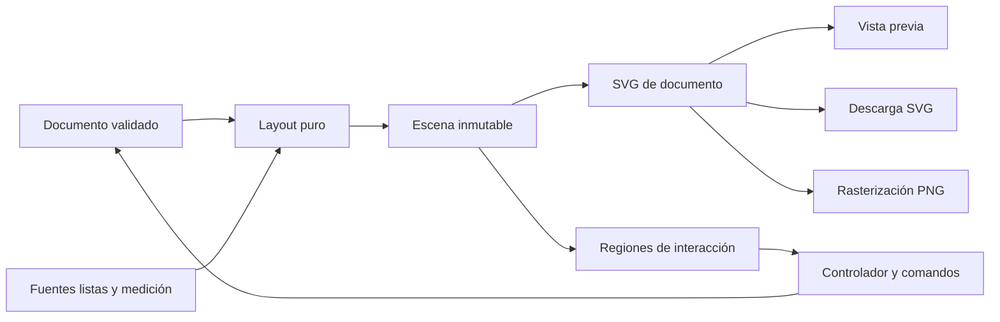

# Motor del editor y exportación

Fecha de revisión: 13 de octubre de 2026. Este documento propone un reemplazo del motor. No implementa cambios en `src`.

La decisión principal es construir una escena de documento independiente de React, del zoom y de la pantalla. El editor muestra esa escena, SVG la serializa y PNG rasteriza el mismo SVG. El modelo separa la materia de sus bloques; la interacción opera en minutos y la escena conserva la geometría y los cortes de texto ya resueltos.

## Qué existe y qué hay que reemplazar

| Archivo real | Comportamiento observado | Consecuencia para el reemplazo |
| --- | --- | --- |
| `src/features/schedule/types.ts:67` | `ScheduleItem` guarda `subject`, `color` y `textColor` por aparición. | Una materia debe tener identidad propia. Renombrarla o cambiar su color debe actualizar todos sus bloques. |
| `src/features/schedule/use-schedule-studio.ts:27` | Estado con `useState`, actualización de campos y persistencia por efecto. No hay selección, gesto ni historial. | Separar documento, estado transitorio de interacción y comandos con historial. |
| `src/features/schedule/utils.ts:130` | El rango automático comienza como mínimo a las 06:00. Las horas vacías reciben peso `0.42` en modo optimizado. | Reemplazar rango e inversa temporal. Congelar la transformación durante cada gesto. |
| `src/features/schedule/utils.ts:196` | El ancho de texto se estima con `fontSize * 0.56`. Una palabra larga queda entera. | Medir avances y contornos reales de la fuente seleccionada. |
| `src/features/schedule/utils.ts:272` | La leyenda reserva filas sin un límite de altura. | Distribuir todas las regiones mediante restricciones y emitir errores de composición. |
| `src/features/schedule/components/schedule-preview.tsx:212` | El bloque ocupa toda la columna y tiene un mínimo visual de 28 unidades. No hay carriles para conflictos. | Duración geométrica exacta y carriles para superposiciones. Ampliar el área de interacción, sin falsificar la duración dibujada. |
| `src/index.css:1` y `src/features/schedule/components/schedule-preview.tsx:101` | Fuentes remotas por `@import`; el SVG nombra Bebas Neue y DM Sans. | Congelar archivos y variantes de fuentes del documento. |
| `src/App.tsx:89` | Serializa el SVG visible, carga un `Image`, dibuja en canvas a 2x y descarga PNG. No incluye las fuentes ni espera su preparación. | Exportar desde una escena lista, autónoma y ligada a una revisión del documento. Añadir descarga SVG. |

Se ejecutaron las funciones reales con Node y la dependencia TypeScript instalada, sin modificar archivos de aplicación. Los resultados confirman cuatro casos adversos: una clase de 05:00 a 06:00 produce un rango que inicia a las 06:00; `sanitizeItem` con inicio 23:59 y fin 20:00 devuelve inicio y fin 23:59; una palabra de 48 caracteres se acepta como una sola línea de 12 unidades dentro de un ancho de 50; una leyenda de 200 entradas en A4 vertical produce `timelineHeight = -1121.7`. Estos ensayos comprueban cálculos, no la apariencia de una captura ni la falla tipográfica efectiva de un navegador.

La prueba de navegador registrada en [browser-results.json](evidence/browser-results.json) agrega evidencia de la exportación actual. Bebas Neue y variantes de DM Sans estaban cargadas en el DOM, pero el SVG serializado carece de `@font-face` y archivos embebidos. La comparación de rasterizaciones cambia 62.271 de 5.656.000 píxeles, un 1,10 %. La captura revisada durante esa prueba muestra un título sans de respaldo en PNG. El porcentaje por sí solo no identifica una fuente; se interpreta junto con el payload y la captura. La misma sesión detectó pantalla vacía al importar un tema inexistente por acceso a `blockRadius` y al provocar un error de cuota. El nuevo importador debe validar enums y la persistencia debe capturar errores fuera del render.

## Modelo y comandos

```ts
type Subject = {
  id: string
  name: string
  color: string
  textColor: string
}

type Block = {
  id: string
  subjectId: string
  dayId: string
  startMinute: number
  endMinute: number
  room: string
  kind: string // Teoría, práctica, laboratorio o texto libre
  notes: string
}

type FontRef = {
  assetId: string
  sha256: string
  weight: number
  style: "normal" | "italic"
  axes: Record<string, number>
}

type ScheduleDocument = {
  schemaVersion: 2
  id: string
  subjects: Subject[]
  blocks: Block[]
  settings: DocumentSettings
  appearance: ResolvedAppearance
}
```

`DocumentSettings` contiene tamaño del documento, días ordenados, título, subtítulo, rango visible y visibilidad de campos. `ResolvedAppearance` contiene colores, radios, bordes, tamaños, espaciado y referencias de fuentes para cada rol. No contiene clases CSS del editor. Todo objeto persistido pasa por validación de estructura, longitud de cadenas, referencias e intervalos. No convertir silenciosamente un dato inválido en una clase distinta.

El dominio acepta minutos enteros entre 0 y 1440, con `0 <= startMinute < endMinute <= 1440`. 1440 es un final válido y se muestra como 24:00. Los nuevos bloques tienen extremos múltiplos de 30 y duración mínima de 30. Los gestos ajustan a esa grilla. El importador conserva horarios antiguos válidos que no estén en la grilla y los marca; al moverlos, ajusta el inicio conservando su duración original, incluso si no es múltiplo de 30. Al redimensionar, ajusta el extremo editado y exige una duración mínima de 30. Esto evita modificar datos importados sin una acción visible. El cruce de medianoche requiere dividir el bloque en dos días; no se interpreta automáticamente `fin < inicio` como el día siguiente.

Los comandos son `CreateSubject`, `UpdateSubject`, `CreateBlock`, `UpdateBlock`, `DeleteBlocks`, `DeleteSubject`, `ApplyAppearance`, `ChangeSettings`, `ImportDocument` y `ResetDocument`. Un reducer valida y aplica cada comando de forma atómica. Borrar una materia con bloques muestra cuántos se borrarán y admite deshacer. Borrar su último bloque conserva la materia en la biblioteca. Materias con el mismo nombre pueden existir; la leyenda se deriva de `subjectId`, nunca de un `Set` de nombres.

El historial guarda documentos anteriores y posteriores inmutables. Un arrastre, un resize, un pegado o una importación crean exactamente una entrada. Una edición de texto se agrupa durante la sesión del campo y termina al perder foco o pulsar Enter; Escape cancela. Después de deshacer, un comando nuevo borra la rama de rehacer. Selección, zoom, hover y copia no entran en el historial. Propuesta inicial: 100 entradas y 10 MB como límite, conservando siempre el estado actual. Medir consumo antes de fijar esos límites. No persistir historial entre sesiones en la primera entrega.

Guardar el documento al confirmar un comando, con manejo de cuota y errores de almacenamiento. Mostrar "No se pudo guardar en este navegador" y mantener disponible el JSON si falla. La persistencia no debe ejecutar escrituras por cada `pointermove`.

### Migración del formato actual

Crear una materia por combinación exacta de nombre, fondo y color de texto. Esto preserva los colores de versiones antiguas aunque dos bloques compartan nombre. No fusionar por similitud, mayúsculas ni acentos. Se pueden sugerir fusiones después de migrar, para una acción explícita del usuario. Conservar `room`; llevar `details` a `notes`; iniciar `kind` vacío. Conservar todos los datos originales en el respaldo JSON de migración. Revisar intervalos inválidos antes de aceptar el documento y presentar los registros afectados. Mantener el archivo antiguo descargable. Las claves de almacenamiento v1 y v2 deben ser distintas hasta verificar la migración.

## Arquitectura propuesta

Los nombres siguientes son módulos nuevos propuestos, no archivos ya implementados.

```text
domain/document.ts        esquema, validación y migración
domain/commands.ts        reducer y transacciones
domain/history.ts         undo/redo y agrupación
engine/time-scale.ts      minuto <-> coordenada, snap y rango
engine/overlaps.ts         grupos y carriles por día
engine/text.ts            composición y medición de texto
engine/layout.ts          composición pura del documento
engine/scene.ts           nodos, cajas, avisos y hit regions
fonts/catalog.ts          manifiesto de Google Fonts fijado
fonts/font-service.ts     bytes, shaping, contornos y caché
interaction/controller.ts máquina de estados de gestos
render/scene-svg.ts        única representación gráfica
export/svg.ts              SVG autónomo
export/png.ts              rasterización del SVG autónomo
storage/documents.ts       persistencia y recuperación
storage/themes.ts          temas guardados
```



`layout(document, resolvedFonts, constraints)` devuelve `Scene`, sin leer DOM, localStorage ni ancho de pantalla. El servicio de fuentes prepara bytes y funciones de medición antes de llamar al layout. Las cachés internas pueden ahorrar trabajo, pero no alteran el resultado. El layout produce regiones de título, subtítulo, grilla y leyenda; nodos con geometría explícita; texto compuesto; y avisos de truncado, conflicto o contenido fuera de rango.

Cada escena tiene un identificador derivado de documento, archivos de fuente, versión del motor y restricciones. La geometría usa unidades del `viewBox`. El zoom adapta el contenedor, no recompone texto. Una pantalla pequeña conserva el documento y ofrece zoom/desplazamiento; el inspector se adapta por separado.

La representación SVG utiliza atributos explícitos, `defs`, clips y colores ya resueltos. Ninguna tipografía, sombra o relleno del documento depende de CSS de la aplicación. No usar `foreignObject`, capturas de HTML ni un segundo layout para exportar. El borde de selección, los handles y el ghost están en una capa de controles separada. La descarga contiene el documento mostrado, sin esos controles. Durante un gesto activo la descarga espera su confirmación o cancelación; un hover sin gesto no cambia la revisión exportable.

## Tiempo, inserción y selección

Para una escala uniforme, `y(t) = gridY + (t - rangeStart) * gridHeight / (rangeEnd - rangeStart)`. La inversa recupera minutos. El snap usa `30 * floor(t / 30 + 0.5)`, con empate hacia la hora posterior. Convertir `clientX/clientY` con la inversa de `getScreenCTM()` del SVG. No dividir por un zoom supuesto; considerar márgenes, scroll y `preserveAspectRatio`.

La primera entrega usa escala uniforme para editar y exportar. Postergar la compactación de horas vacías. Una composición comprimida futura será opt-in y compartida entre vista y exportación; `TimeScale` deberá tener segmentos con pendiente positiva, `minuteToY`, `yToMinute` y búsquedas sobre acumulados. Congelar escala, rango y geometría de grilla al comenzar cada gesto. Un cambio de tamaño o ajuste de documento durante el gesto lo cancela.

El rango automático abarca todos los bloques, redondeado hacia afuera a 30 minutos y con 30 minutos de margen por extremo, limitado a 00:00–24:00. Con documento vacío usar 08:00 a 21:00. No imponer un piso de 06:00. Al aplicar un rango manual o quitar días, validar primero que todos los bloques sigan visibles. Si el ajuste excluye alguno, bloquearlo y ofrecer ampliar rango, mover o borrar los bloques mediante acciones explícitas. No cambiar sus horas ni recortarlos al aplicar un ajuste normal. Los casos fuera de rango sólo existen como recuperación de v1 o error detectado; requieren reparación y bloquean la exportación.

La máquina de interacción tiene estados `idle`, `inserting`, `moving` y `resizing`. Guarda `pointerId`, revisión de origen, posición de anclaje, geometría congelada y borrador. El movimiento actualiza sólo el borrador, como máximo una vez por frame. `pointerup` valida y confirma; Escape, `pointercancel`, pérdida de captura o de foco de ventana restauran el original. Capturar el puntero durante el gesto y liberarlo al terminar. La especificación permite continuar recibiendo eventos fuera del elemento al usar `setPointerCapture`. `touch-action` se decide antes del gesto y sólo sobre sus zonas; mantener disponibles el desplazamiento y el zoom del área restante. [Pointer Events, W3C](https://www.w3.org/TR/pointerevents/latest/).

Al elegir una materia, el cursor sobre una celda vacía muestra un ghost de 60 minutos con hora inicial ajustada. Guardar en estado de sesión la duración de la última creación o resize por `subjectId` y reutilizarla, con 60 minutos como valor inicial. No guardar ese dato como propiedad permanente de la materia. El click confirma. Al arrastrar desde el inicio se puede extender su final en pasos de 30. El ghost muestra nombre, aula/tipo si existen, intervalo y aviso de conflicto. Cerca del final del rango, desplazar el inicio hacia arriba hasta que entre la duración completa. Si el rango es menor a la duración recordada, el candidato ocupa el rango completo, con mínimo de 30; fuera de la grilla se oculta. La memoria cambia sólo al confirmar. Se puede insertar en una franja ocupada mediante una acción explícita de agregar bloque, que anticipa el carril de conflicto. En táctil se selecciona materia y se toca la celda; no depender de hover.

Seleccionar un bloque sincroniza el inspector y la lista de materias. Un click en vacío quita la selección. La primera entrega tiene selección de un bloque; la estructura `selectedBlockIds` deja abierta una selección múltiple posterior. No implementar mover varios hasta definir cómo preservan días e intervalos.

Mover conserva duración y el punto tomado dentro del bloque. Calcula el inicio desde el puntero menos ese offset y luego ajusta. Cambiar de columna cambia el día. Clamp del inicio entre `rangeStart` y `rangeEnd - duration` durante la manipulación visible; no acortar el bloque al llegar al borde. Un bloque importado que no entra en el rango activa reparación desde el inspector o ampliación del rango; no se manipula sobre una geometría recortada.

El handle superior cambia sólo el inicio; el inferior cambia sólo el final. Nunca intercambian extremos. Inicio y fin se limitan a mantener al menos 30 minutos en bloques nuevos y editados. Los controles del inspector "Inicio -30 min", "Inicio +30 min", "Fin -30 min" y "Fin +30 min" modifican esos mismos extremos. Una acción separada "Mover -30 min" o "Mover +30 min" desplaza el intervalo entero. Deshabilitar acciones que crucen un límite y anunciar la razón.

Los handles visibles pueden ser pequeños, pero sus zonas activas deben ser distinguibles y no superponerse. En bloques demasiado pequeños al zoom actual, mostrar los controles de extremos en la barra del bloque o en el inspector, con objetivos de al menos 24 por 24 píxeles CSS. El tamaño físico de los controles no cambia la caja horaria.

## Teclado, copia y temas

Con foco en el estudio: flechas arriba/abajo desplazan 30 minutos; izquierda/derecha cambian día; Delete o Backspace borra la selección; Escape cancela un gesto o limpia selección; Ctrl/Cmd+Z deshace; Ctrl/Cmd+Shift+Z rehace y Ctrl+Y sirve como alternativa. Los controles del inspector permiten redimensionar sin mouse. Después de borrar, devolver foco al siguiente bloque o a la grilla. Usar una región de estado para anunciar una confirmación, por ejemplo "Práctica movida al martes de 10:00 a 11:30". No anunciar cada `pointermove`.

Los atajos no se interceptan dentro de inputs, textareas, `contenteditable` ni controles compuestos que usen esas teclas. Durante composición IME no ejecutar comandos. La lista y el inspector proporcionan nombres y controles semánticos; los contornos SVG no reemplazan el árbol accesible del editor.

Copiar guarda un payload versionado con el bloque y la materia necesaria. Dentro del mismo documento, pegar crea un nuevo `blockId` y reutiliza `subjectId`; pegar entre documentos crea o vincula una materia sólo si existe una coincidencia exacta y documentada, nunca por nombre a secas. El destino es la celda elegida; si no hay destino, abrir un candidato de colocación en el intervalo original que exige confirmación. Bloquear un candidato exactamente igual a otro y ofrecer elegir otra posición. El pegado confirmado es una transacción y selecciona el nuevo bloque. Se admiten los demás conflictos visibles; no desplazarlo automáticamente a otro horario. Usar copia interna como base y texto JSON en el portapapeles del sistema cuando esté disponible. Si el navegador no autoriza el portapapeles, mantener copiar/pegar internos y explicar ese alcance.

Un tema guardado es `{id, name, themeSchemaVersion, appearance}`. Guarda composición y fuentes, sin bloques ni materias. Aplicar un tema copia todos sus valores resueltos al documento y se puede deshacer. Editar luego un tema de la biblioteca no cambia documentos que ya lo aplicaron. Reservar una acción distinta para guardar documento como plantilla. Persistir biblioteca de temas por separado y validar sus versiones al importar.

## Fuentes y composición real del texto

Recomiendo usar contornos tipográficos como representación gráfica canónica. `harfbuzzjs` documenta carga de TTF, shaping, avances y offsets por glifo, y extracción de contornos SVG mediante `glyphToPath`. Esto permite medir y dibujar con los mismos datos. Elegir y fijar una versión de la biblioteca después de comprobar su compilación en Vite y el tamaño del WASM. [Repositorio oficial de harfbuzzjs](https://github.com/harfbuzz/harfbuzzjs).

Las familias siguen siendo Google Fonts. El catálogo inicial debe ofrecer familias verificadas, con archivos TTF/OTF locales, pesos reales, hashes y licencia por familia. Publicar las fuentes como assets separados y cargar sólo las elegidas. El repositorio oficial ofrece archivos y licencias en cada directorio; conservar esos avisos en la distribución. [Repositorio de Google Fonts](https://github.com/google/fonts).

Una ampliación al catálogo completo requiere un manifiesto generado y un mecanismo de descarga/caché de archivos compatibles. No asumir que el CSS de Google equivale a un archivo estable: la API permite seleccionar variantes, ejes y subconjuntos `text=`. Ese subconjunto no sirve para un documento que aún recibirá letras nuevas. La opción de "cualquier Google Font" no se considera terminada con una lista de nombres que el motor no puede cargar y exportar. [Google Fonts CSS API](https://developers.google.com/fonts/docs/css2).

El servicio de fuentes tiene estados `loading`, `ready` y `error`, por archivo y variante. Una elección nueva se confirma cuando sus bytes, cobertura y contornos están preparados. Hasta entonces mantener visible la escena anterior y mostrar el estado. Una fuente que falla no provoca una exportación silenciosa con otra. Ofrecer reintentar o aplicar explícitamente una fuente local disponible. El JSON persiste identidad y hash de assets, no sus bytes; reabrir offline requiere tenerlos descargados.

Medir una línea con el shaping de la cadena completa, incluidos kerning, ligaduras, espacios y ejes fijados. Sumar avances para composición y comprobar límites de tinta para que acentos o cursivas no escapen. Escalar métricas de fuente por `fontSize / unitsPerEm`; transformar el eje vertical de contornos una sola vez. Fijar idioma, dirección, características OpenType y `opsz` en el rol tipográfico. La caché incluye hash de fuente, tamaño, ejes, características, idioma, dirección, texto y ancho disponible.

El compositor preserva saltos de línea y divide por oportunidades de palabra. Para una palabra demasiado larga, divide por grafemas y busca el mayor fragmento que entra. Nunca cortar por unidades UTF-16. Tras decidir una línea vuelve a hacer shaping de esa línea completa, porque sus límites pueden cambiar ligaduras. Hay que probar `ñ`, vocales acentuadas, signos de apertura, combinaciones Unicode, cifras y símbolos usados en materias. Para escrituras bidireccionales, HarfBuzz resuelve shaping de runs; hace falta segmentación por dirección y escritura antes de componer una mezcla. No prometer soporte universal por usar HarfBuzz.

La cobertura debe ser explícita: comenzar con español y latín extendido, con una fuente local de respaldo fijada para símbolos admitidos. Si faltan glifos, mostrar cuáles y pedir elegir una fuente compatible o corregir el texto, conservando siempre la cadena original. Emoji de color y fuentes con formatos de color son un spike separado. Si no se soportan aún, la aplicación debe indicarlo; nunca exportar un cuadrado en su lugar sin aviso.

### Alternativas evaluadas

| Ruta | Ventaja | Límite y decisión |
| --- | --- | --- |
| SVG con `<text>` y WOFF2 embebida por `@font-face` + URL `data:` | Texto seleccionable y archivos normalmente más pequeños. Medición DOM con la misma fuente. | Validar en Chromium, Firefox, Safari y visores externos; no asumir soporte de fuentes embebidas en todos. Alternativa si supera el spike de fidelidad. |
| SVG con contornos de HarfBuzz | Geometría y glifos compartidos entre vista y exportación, sin resolución de fuentes en el destino. | Pierde selección de texto y aumenta tamaño. Ruta recomendada para fidelidad visual, condicionada al spike de bundle y fuentes. |
| Fontkit para métricas y contornos | Documenta WOFF2, shaping y extracción SVG. | Alternativa concreta si simplifica carga frente a HarfBuzz. Comprobar variantes y scripts del catálogo antes de adoptarla. [Fontkit](https://github.com/foliojs/fontkit). |
| OpenType.js | Contornos directos para fuentes compatibles. | WOFF2 requiere descompresión previa según su documentación; no elegirlo suponiendo que puede leer sin más lo devuelto por Google Fonts. [OpenType.js](https://github.com/opentypejs/opentype.js). |
| Captura HTML o canvas con layout propio | Menos trabajo inicial para mostrar texto HTML. | Duplica reglas de layout y complica SVG vectorial. Descartada para este requisito. |

SVG procesado como imagen restringe recursos externos; las URLs `data:` tienen tratamiento distinto. Por eso serializar el nodo inline actual no transporta automáticamente las fuentes de su página. [Modos de procesamiento de SVG, W3C](https://www.w3.org/TR/SVG/conform.html).

Si el spike elige texto embebido, cargar cada `FontFace` requerida de forma explícita, comprobar sus errores y luego esperar `document.fonts.ready`. Esa promesa indica que el documento terminó su ciclo de carga/layout, pero se cumple también cuando hay fallas y puede haber fuentes nuevas después. No basta como prueba de éxito de la variante ni prepara automáticamente el documento independiente cargado en un `Image`. [CSS Font Loading, W3C](https://www.w3.org/TR/css-font-loading-3/).

## Conflictos, desbordes y contenido perdido

| Caso | Política |
| --- | --- |
| Dos bloques superpuestos | Se permiten y muestran en carriles paralelos del mismo día. Mostrar también estado "Se superpone" en inspector. No esconder uno detrás de otro. |
| Intervalos que sólo se tocan | Usar intervalos semiabiertos `[inicio, fin)`. 10:00 a 11:00 y 11:00 a 12:00 no son conflicto. |
| Cadena de superposiciones | Agrupar por componente conexo temporal. Ordenar por inicio, fin e ID; asignar el primer carril libre y usar el máximo de carriles del grupo. Mismo documento produce el mismo orden. |
| Muchos conflictos estrechan texto | Mantener carriles reales, aplicar composición/truncado y mostrar aviso. Permitir aumentar ancho/formato. No ensanchar un bloque tapando otro. |
| Cambio de rango o días excluye bloques | Bloquear el ajuste e identificar los bloques afectados. Ofrecer ampliar, mover o borrar de forma explícita; no recortar ni esconder. |
| Bloque importado parcial fuera del rango | Abrir modo de reparación con horas completas en inspector y banner. La vista diagnóstica puede indicar el borde, pero no es un documento exportable. |
| Bloque importado completamente fuera del rango o día | Mostrarlo en la lista de reparación y ofrecer "Ampliar rango" o restaurar día. Conservarlo en JSON, sin dibujarlo en una hora falsa. |
| Exportación con bloques fuera de rango | Bloqueada hasta reparar. Todo bloque válido debe ocupar un lugar visible en la composición; un aviso de cantidad omitida no sustituye su contenido. |
| Texto de bloque no cabe | Prioridad: nombre, intervalo, tipo/aula y notas. Reducir hasta el mínimo definido por el rol; luego truncar con elipsis medida. Todas las líneas tienen clip. El original sigue disponible en inspector y JSON. |
| Campo oculto por ajuste | Es una elección de presentación. No eliminarlo del bloque ni añadirlo oculto al SVG sin decisión explícita del usuario. |
| Título largo | Reservar hasta dos líneas medidas; después truncar y avisar. No permitir que cubra días o grilla. |
| Leyenda muy grande | Medir entradas y filas antes de reservar espacio. Mantener una altura mínima de grilla; si no entra, ofrecer formato mayor o quitar leyenda. No omitir materias ni devolver geometría negativa. El layout inválido no se puede exportar. |
| JSON importado incorrecto | Listar errores con bloque/campo y no reemplazar el documento actual. Validar IDs únicos, días, enums, colores, referencias y minutos. |

PNG contiene sólo píxeles. SVG con contornos contiene geometría y puede incorporar `<title>`/`<desc>` con texto visible para descripción accesible, pero no conserva la edición del horario. Ninguno sustituye el JSON. No incrustar notas ocultas, bloques fuera de rango ni todo el documento en `<metadata>` de manera predeterminada: compartir una imagen no debe transmitir campos que el usuario decidió ocultar. El exportador describe qué contenido se omitirá en la revisión de exportación y ofrece descargar JSON por separado.

## Exportación y significado de "exactamente lo que se ve"

La garantía es misma revisión, dimensiones, geometría, contornos, líneas de texto, colores y contenido del documento. No se promete igualdad de píxeles entre navegadores o entre un SVG a cualquier zoom y un PNG a otra resolución: antialiasing y rasterización pueden variar. No exportar una revisión diferente si el usuario edita mientras se carga una fuente.

1. Capturar documento confirmado y revisión. Resolver todas sus fuentes, componer y comprobar `Scene.issues`.
2. Obtener `svgString` de la misma escena que muestra el documento. Incluir `xmlns`, `width`, `height`, `viewBox`, estilos autónomos y todos sus `defs`. Escapar texto y atributos; no serializar HTML de usuario.
3. Para SVG, descargar esos mismos bytes. El archivo no realiza solicitudes de red ni depende de una fuente instalada.
4. Para PNG, cargar esos bytes en un `Image`, esperar carga/decodificación y dibujar a escala elegida en un canvas del tamaño final. Usar `toBlob`, comprobar `null` y manejar excepción o límite de memoria. Revocar URLs incluso en error.
5. Mostrar tamaño final, por ejemplo 2000 por 2828 píxeles para A4 vertical 2x. La escala PNG aumenta resolución, no modifica layout ni cortes de línea.

Establecer inicialmente máximo de 16 megapíxeles y lado de 8192 píxeles; son límites del producto a validar, no garantías universales de canvas. Eliminar imágenes externas y filtros no verificados de la escena inicial reduce diferencias y errores. Si se agrega imagen de fondo, requerir bytes locales incorporados antes de exportar.

`resvg` es una alternativa para PNG reproducible con una versión fijada y fuentes controladas. Su proyecto describe reproducción independiente de bibliotecas del sistema y un subconjunto SVG estático. Hace falta validar WASM, costo de descarga y efectos utilizados. Si se usa sólo para PNG, no desaparecen las diferencias respecto de la vista SVG del navegador. Para igualdad estricta de píxeles, añadir una vista de exportación basada en el mismo PNG generado por resvg. [Repositorio oficial de resvg](https://github.com/linebender/resvg).

## Spikes antes de comprometer dependencias

Estos ensayos están pendientes. La revisión del código y de las fuentes técnicas no demuestra que una implementación nueva ya pase.

| Spike | Ensayo y resultado exigido | Decisión que resuelve |
| --- | --- | --- |
| Texto canónico | Tres familias Google, pesos 400/700, una variable, acentos compuestos, `AV`, `fi`, palabra de 120 grafemas y símbolo matemático. Generar métricas y contornos; comparar cajas de tinta y líneas con el SVG. | Si HarfBuzz cumple, usar un solo motor. Si falla una fuente, adaptar el catálogo o probar Fontkit sin mezclar métricas de un motor con contornos del otro. |
| SVG con fuente embebida | Mismo fixture inline, SVG descargado, `` y PNG, con red desconectada y fuente no instalada. Ejecutar en Chromium, Firefox y Safari, más un visor vectorial disponible. | Admitir `<text>` embebido sólo con resultados documentados. En caso contrario, contornos. |
| Shaping y cobertura | Español, ligaduras, marcas combinadas, RTL mezclado y emoji. Detectar glifos ausentes antes de renderizar. | Definir idiomas/formato soportados y fallbacks concretos, sin sustituciones silenciosas. |
| Interacción con transformaciones | Grilla uniforme a zoom 50/100/200%, página scrolleada y contenedor con márgenes. Probar bordes, `pointercancel` y captura perdida. | Validez de conversión puntero/minuto y política de cancelación. La compresión queda fuera de la primera entrega. |
| Exportación | Cinco formatos existentes en `ASPECT_RATIOS`, 0/1/100 bloques y 0/10/100 materias. 1x/2x, fuente lenta/fallida y cambio de revisión durante exportación. | Presupuesto de memoria, tiempos y bloqueo de layouts inválidos. |
| Rendimiento | Medir bundle agregado comprimido, preparación inicial y actualización de un bloque con 100 bloques. Cargar motor/fuentes bajo demanda. | Worker sólo si las mediciones justifican su costo; conservar el layout desacoplado para poder moverlo. |

## Roadmap técnico y aceptación

1. Modelo, validación y comandos. Migrar fixtures v1 sin perder aula, detalle, color ni minutos; un comando deshecho y rehecho debe reconstruir documentos iguales en 100 secuencias aleatorias. Importaciones inválidas no modifican el documento vigente.
2. Spike de fuentes y motor de escena. Aprobar catálogo y dependencia antes de diseñar presets. Todas las cajas son finitas y no negativas; mismas entradas producen igual escena serializada. Para los cinco formatos, comprobar que título, grilla y leyenda no se invaden. Ningún glifo renderizado sale de su clip.
3. Interacción. Un movimiento de puntero produce intervalos ajustados correctos a todos los zooms probados. Veinte frames de un arrastre crean una sola entrada de historial; cancelar crea cero. Handles y botones producen el mismo intervalo. Mover conserva duración. Agregar, seleccionar, mover, resize, borrar, copiar/pegar y undo/redo se completan con teclado.
4. Exportación. SVG descargado y escena visible tienen el mismo identificador y nodos gráficos. Abrir SVG offline no genera peticiones. PNG tiene dimensiones exactas a 1x/2x y coincide con una rasterización de esos mismos bytes en el mismo motor. Aplicar un rango o quitar un día que excluya bloques deja el documento intacto; recuperar v1 fuera de rango muestra reparación y mantiene exportación bloqueada. Para comparación entre navegadores, verificar geometría y líneas, y registrar diferencias de rasterización sin confundirlas con pérdida de contenido.
5. Persistencia y temas. Recargar recupera documento y biblioteca de temas. Aplicar y deshacer tema restaura todos los valores y fuentes. Una actualización de la biblioteca no cambia un documento existente. Una falla de cuota mantiene estado en memoria y ofrece JSON.

Como presupuesto inicial, el fixture de 100 bloques debe permitir arrastre con trabajo por frame por debajo de 16 ms en percentil 95 y exportar PNG 2x en menos de 2 segundos después de preparar las fuentes. Registrar navegador, equipo y tamaño real del bundle con esas mediciones. Si no se cumple, corregir la etapa costosa identificada; no introducir un worker ni otra biblioteca sólo por anticipación.

Las pruebas unitarias pertenecen al dominio, rango/inversa, carriles y composición. Las pruebas de integración cubren transacciones e historial. Las pruebas visuales comparan escenas y exportaciones con fuentes fijadas. Build y lint existentes siguen siendo controles necesarios, pero por sí solos no verifican la fidelidad de PNG/SVG.
